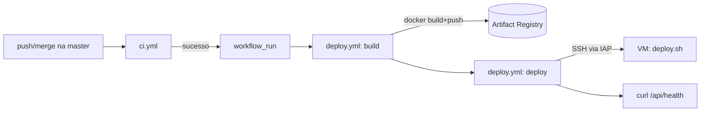

# Deploy de novas versões via CI/CD

Como uma mudança no código chega em produção depois que a infraestrutura (Terraform) já existe. Para subir a infra do zero, ver [README.md](README.md).

## Pré-requisito: `.github/workflows` precisa estar na `master`

`ci.yml` e `deploy.yml` só dão gatilho automático (`workflow_run`) ou manual (`workflow_dispatch`) se já existirem na branch padrão do repositório. Isso é uma regra do GitHub Actions, não tem como contornar no código do workflow: enquanto esses arquivos só existirem numa branch de feature, nada aqui funciona sozinho — nem o botão "Run workflow", nem o deploy automático depois do `ci`.

**Checklist antes de confiar neste documento:**
- [ ] PR da branch que trouxe `.github/workflows/*` já foi mesclado na `master`.
- [ ] As 7 repository **Variables** estão definidas (Settings → Secrets and variables → Actions → aba Variables): `GCP_PROJECT_ID`, `GCP_ZONE`, `GCP_VM_NAME`, `GCP_REGISTRY`, `GCP_WIF_PROVIDER`, `GCP_DEPLOY_SA`, `APP_URL`. Valores atuais em `terraform output github_variables`.

## Visão geral



Cada deploy usa o **SHA do commit** como tag de imagem. Não existe tag `latest`: a imagem que sobe é sempre rastreável até o commit exato.

## 1. O que dispara um deploy

- **Automático:** qualquer push na `master` (direto ou merge de PR) dispara o `ci`. Se o `ci` passar (`backend` e `frontend` com sucesso), o `deploy` dispara sozinho via `workflow_run`, para o mesmo SHA que foi testado.
- **Manual:** aba **Actions** → workflow **deploy** → **Run workflow** → branch `master`. Usa `github.sha` da `master` no momento do clique. Equivalente por CLI: `gh workflow run deploy --ref master`.

Só existe deploy pra `master`. Não há deploy automático de outras branches nem de PRs.

## 2. O job `build`

1. Faz checkout do SHA exato que vai ser implantado.
2. Autentica no GCP via **Workload Identity Federation** (`google-github-actions/auth@v2`, usando `GCP_WIF_PROVIDER`/`GCP_DEPLOY_SA`) — sem chave JSON, token de curta duração.
3. `docker build` + `push` de duas imagens pro Artifact Registry (`GCP_REGISTRY`):
   - `api:<sha>` — contexto raiz (`Dockerfile`), serve `api` e todos os `worker_*`.
   - `frontend:<sha>` — contexto `frontend/`, compilado com `VITE_API_URL=$APP_URL` e `VITE_API_PREFIX=/api`.
4. Cache de build via GitHub Actions cache (`cache-from`/`cache-to: type=gha`), separado por imagem — builds seguintes reaproveitam camadas.

## 3. O job `deploy`

Roda só se `build` terminar com sucesso. Usa o environment `production` (criado automaticamente pelo GitHub na primeira execução — não precisa configurar nada em Settings antes).

1. Autentica no GCP (mesmo WIF).
2. `gcloud compute ssh` com `--tunnel-through-iap` (porta 22 não é exposta publicamente; o túnel do IAP é a única forma de entrar) e roda, como root: `sudo /opt/ai-doc-factory/deploy.sh <sha>`.
3. O `deploy.sh`, já gravado na VM pelo bootstrap do Terraform:
   - `git fetch`/`checkout` do commit exato na VM (só pra alinhar o `docker-compose.yml` usado pelo `docker compose`; as imagens já estão prontas, isso não builda nada).
   - Baixa a última versão do `.env` do Secret Manager (`<name>-env`), remove `CORS_ORIGINS`/`IMAGE_TAG` antigos e grava os dois de novo (`CORS_ORIGINS=https://<domínio>`, `IMAGE_TAG=<sha>`).
   - `docker login` no Artifact Registry com o token da SA da VM.
   - `docker compose pull` + `up -d --remove-orphans`, com o override `docker-compose.gcp.yml`.
   - Grava o SHA em `/opt/ai-doc-factory/IMAGE_TAG` e remove imagens locais com mais de 7 dias (`docker image prune`).
4. O workflow faz `curl` em `$APP_URL/api/health`, com até 20 tentativas (6s de intervalo) — cobre o tempo do Caddy obter/renovar o certificado TLS e do `migrate` terminar antes da `api` responder.

Esse script é o mesmo pra deploy, redeploy e rollback — só muda o SHA que você passa.

## 4. Acompanhar um deploy

```bash
gh run list --workflow deploy --limit 5
gh run watch                      # acompanha a execução em andamento
```

Pela aba **Actions** do GitHub: workflow **deploy**, cada execução mostra os dois jobs (`build`, `deploy`) e, dentro de `deploy`, o link pro environment `production` com a URL (`APP_URL`) clicável.

## 5. Rollback

Não existe botão de rollback — é o mesmo mecanismo do deploy, só apontando pra um SHA anterior que já tenha sido implantado (a imagem dele ainda existe no Artifact Registry; a política de limpeza mantém as 5 versões mais recentes, então um rollback pros últimos deploys sempre tem a imagem disponível):

```bash
gh workflow run deploy --ref <sha-ou-branch-antigo>
```

Ou, direto na VM (mesmo efeito, sem depender do GitHub Actions):

```bash
gcloud compute ssh ai-doc-factory --zone us-central1-a --project <project_id> --tunnel-through-iap \
  --command "sudo /opt/ai-doc-factory/deploy.sh <sha-antigo>"
```

A imagem com aquele SHA precisa já existir no Artifact Registry — se tiver mais de 7 dias e tiver sido apagada pela política `delete-old`, mas ainda estiver dentro das 5 mais recentes (`keep-recent`), ela continua lá; fora isso, precisa rebuildar.

## 6. Problemas comuns

| Sintoma | Causa provável |
|---|---|
| Workflow não aparece pra rodar manualmente | `deploy.yml` ainda não está na `master` (ver checklist no topo) |
| `deploy` nunca dispara sozinho depois do `ci` | Mesmo motivo — `workflow_run` também exige o arquivo na `master` |
| Falha de auth (`unauthorized_client`, `iam.serviceAccounts.getAccessToken`) | Branch ou repositório diferente do configurado no WIF (`deploy_branch`/`github_repository` no `terraform.tfvars`) |
| SSH falha (`Permission denied (publickey)`) | Propagação do OS Login na primeira vez — rodar o job de novo |
| Smoke test falha, mas a VM está ok | `migrate` ou Caddy (TLS) ainda terminando — ver seção 14 do [README.md](README.md) pra mais casos |

Mais detalhes de arquitetura, custos e troubleshooting completo: [README.md](README.md).
